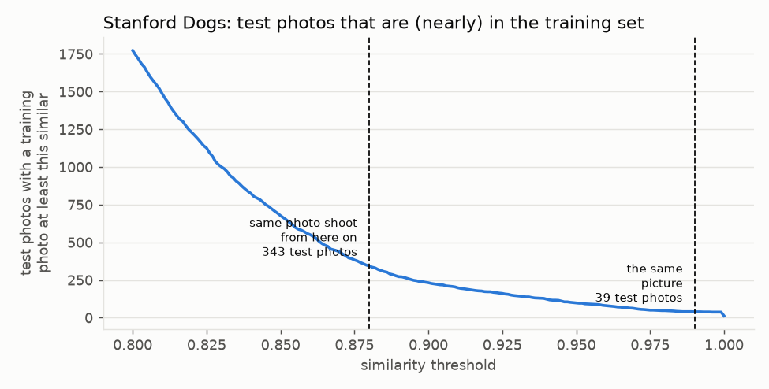
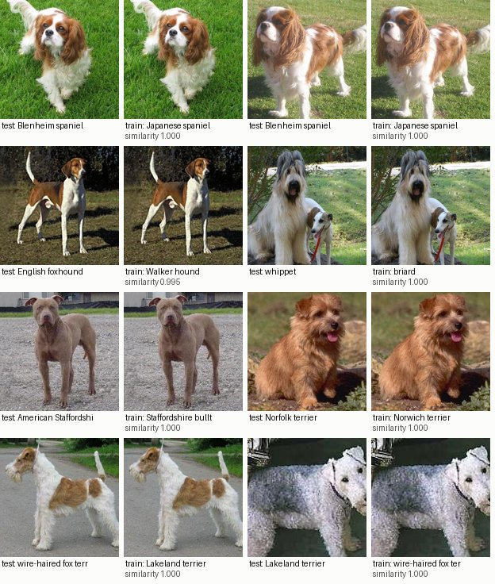
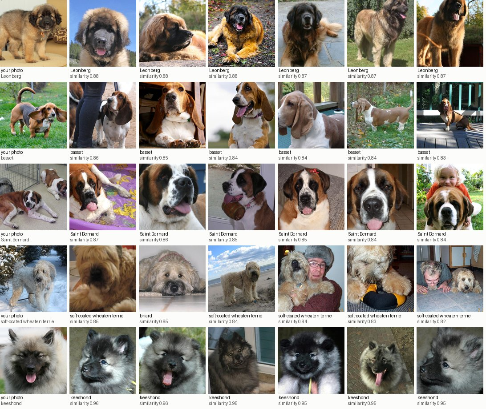
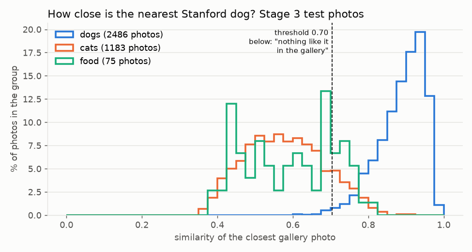

# Stage 8: dogs that look like yours

**Goal:** a different way to use the model. Instead of naming a breed, we **find the photos that look most like yours** among the 12,000 Stanford Dogs training photos. That's a **similarity search** over **embeddings**, the same idea behind image search, recommendation systems and the "retrieval" in RAG.

**Result:** the "Stage 8" tab. Upload a photo to see:
- the stage 3 answer;
- the 4–16 most similar gallery photos, each with its breed and similarity;
- how many of them share one breed.

If nothing in the gallery is close (a cat, a pizza), the tab says so instead of pretending. Below the demo are the measurements, plus a finding about the dataset: the search found **copied photos, some filed under two different breeds**.

**The outcome, up front:**
1. **The search works with no training at all.** For a Stanford test photo, 4.4 of the 5 most similar gallery photos (87%) are the same breed. Letting the 10 closest photos vote gives the right breed 91.6% of the time, against 95.1% for ImageNet's trained head. The head is still better at *naming* the breed; the search is better at *showing why*.
2. **64 numbers per photo are enough.** Compressing each embedding from 1,408 to 64 numbers (PCA) costs almost nothing, and the whole index is 6 MB. One search takes 0.2 ms.
3. **It found copies in Stanford Dogs.** 39 test photos are also in the training set, 15 of them under a different breed. The conflicting pairs are exactly the look-alikes from stage 4.

## What an embedding is

Since stage 5 we've split the model into two parts:

```
photo ──backbone──> 1,408 numbers ──head──> a score per breed
```

Those 1,408 numbers are an **embedding**: the photo as a point in a 1,408-dimensional space. The backbone was trained to make breeds easy to separate, so photos that look alike (same breed, same pose, same colours) end up **close together** in that space. In stages 5 and 6 a head read the numbers. Here, we compare them directly:

```
gallery: 12,000 Stanford training photos ──backbone──> 12,000 embeddings   (done once, saved: "the index")
your photo ──backbone──> 1 embedding ──compare with all 12,000──> the closest ones
```

### "Close" = cosine similarity

We measure closeness by the **angle** between two embeddings, ignoring their length: the **cosine similarity**. It's 1 for the same direction, 0 for unrelated and −1 for opposite. Two preparation steps:

1. **Centre:** subtract the gallery's average embedding. Every photo shares a big "this is a photo of a dog" part. Removing it leaves what makes each photo *different*.
2. **Normalise:** scale every embedding to length 1. Then cosine similarity is a plain **dot product**, and comparing your photo with all 12,000 is a single matrix multiplication (`dogbreeds/similar.py`).

### Optional: PCA

**PCA** (principal component analysis) finds the directions in which the gallery varies most. Keeping only the top 64 directions turns 1,408 numbers into 64: a smaller index and a faster search, with most of the information kept. It's the same thing a vector database does when it compresses vectors, at a small scale.

## Step by step

`scripts/stage8_similar.py` takes under a minute, because it reuses the embeddings cached in stage 5.

### Step 1: choose how to compare, on validation photos

As in stage 5, decisions are made on **validation** photos, never on the test photos. The gallery is 90% of the training set and the queries are the other 10% (the same split as stage 5). We measure:

- **Precision@5:** of the 5 most similar photos, how many are the query's breed?
- **k-NN accuracy:** let the 10 most similar photos vote, each weighted by its similarity, and check whether the winning breed is right. This is the **k-nearest-neighbour classifier**: a "model" with no training, where the gallery *is* the model.

**The rule, set before running:** take the **smallest** index whose precision@5 is within 0.5 points of the best.

| How embeddings are compared | Numbers per photo | Precision@5 | k-NN accuracy |
|---|---|---|---|
| Cosine similarity, raw embeddings | 1,408 | 86.9% | 91.8% |
| Centred, then cosine | 1,408 | 86.9% | 91.8% |
| Centred, PCA to 256, cosine | 256 | 87.6% | 91.8% |
| Centred, PCA to 128, cosine | 128 | 87.6% | 91.2% |
| **Centred, PCA to 64, cosine** ✅ | **64** | 87.3% | 90.9% |

The differences are small: these embeddings are good to begin with. Centring changed nothing here; it matters more for embeddings that all point roughly the same way. PCA to 64 is within 0.3 points of the best on precision@5, so the rule picks it. It's slightly worse on k-NN accuracy (0.9 points), which the rule didn't look at. That's the trade-off a rule fixes in advance: we chose the search quality users see (the photos shown), not the vote.

### Step 2: build the index

All 12,000 training photos, centred, PCA'd to 64 numbers and normalised, are saved as `models/stage8_index.npz`: **6 MB** in 16-bit numbers, with each photo's breed and file path. One search over 12,000 photos takes **0.2 ms** on a laptop. Running the backbone on your photo (about 0.3 seconds on this laptop's CPU) is what takes the time: the search is over 1,000 times faster.

**Brute force is fine here.** We compare with every gallery photo. For millions of items you'd use an approximate search (a vector database such as FAISS, or pgvector), which skips most comparisons and accepts occasionally missing a true nearest neighbour. At 12,000 photos there's no need.

### Step 3: look for copies

For every Stanford test photo, we find its single most similar **training** photo, using all 1,408 numbers. PCA'd similarities run higher, because there are fewer numbers left to disagree on. Then we look at pairs at different similarity levels:

| Similarity of the closest training photo | What the pairs we looked at were | Test photos |
|---|---|---|
| ≥ 0.99 | **The same picture** (resized or re-saved) | 39 |
| 0.88 – 0.99 | **The same photo shoot:** the same dog, minutes apart | 304 more |



**15 of the 39 copies have a different breed in each set**, and 17 more photos are copied *within* the training set under two breeds. They're the look-alike pairs from stage 4: Norfolk / Norwich terrier, Blenheim / Japanese spaniel, wire-haired fox / Lakeland terrier, English foxhound / Walker hound. **The dataset's makers confused the same breeds the model does.** One pair is a genuine double: a whippet and a briard in one photo, filed under each.



What it means for our numbers:
- **Some of the model's "mistakes" on these photos aren't mistakes.** When the same picture is a Norfolk terrier in one set and a Norwich terrier in the other, no model can be right on both.
- **Do copies inflate the scores?** Barely. Without the 343 test photos that have a same-shoot photo in the gallery, precision@5 goes from 87.4% to 87.2%. They're 4% of the test set.
- **The lesson:** near-duplicate detection is one of the most practical uses of embeddings. It cleans datasets, finds leakage between train and test, and removes repeated items from search results. Stage 4 *suspected* leakage between ImageNet and Stanford Dogs. Here we can see some of it directly.

### Step 4: test, once

| Test photos | Closest photo is the same breed | Precision@5 | k-NN accuracy | ImageNet's head (stage 4) |
|---|---|---|---|---|
| Stanford Dogs test (8,580) | 88.7% | 87.4% | 91.6% | 95.1% |
| … without the 343 with a same-shoot photo in the gallery | 88.6% | 87.2% | 91.5% | – |
| Oxford dogs (another collection, 21 breeds) | 87.0% | 85.5% | 88.2% | 90.3% |



- **No training, 3–4 points behind a trained head.** The k-NN classifier is a strong, cheap baseline. It also has a property the head doesn't: **adding a breed means adding photos**, with no retraining.
- **On Oxford's photos, the gap narrows** (88.2% vs 90.3%). The test photos come from a different collection, so this isn't the copies helping.
- A caveat as in stage 4: the backbone itself was trained on ImageNet, which overlaps Stanford Dogs. The embeddings may be a little too good on these photos. Oxford is the fairer check.

### Step 5: can similarity tell a dog from a cat?

A search **always returns something**. Upload a pizza and you still get "the 8 most similar dogs". So we need a check. The idea: if even the closest gallery photo isn't close, the photo is unlike anything in the gallery. The threshold is the similarity that keeps 99% of dogs on stage 3's "choose" photos: **0.70**. Checked on stage 3's test photos:

| Stage 3 test photos | Median similarity of the closest gallery photo | Flagged "nothing like it" |
|---|---|---|
| Dogs (2,486) | 0.90 | 0.8% |
| Cats (1,183) | 0.57 | 86.6% |
| Food (75) | 0.61 | 80.0% |



It works, but **stage 3's rule is better**: ImageNet's "how much of the probability is on dog classes" keeps 97.5% of dogs and turns away 95.7% of cats and all the food. So the tab uses stage 3's answer as the main check and the similarity only as a warning. When the closest photo is below 0.70, it doesn't show a breed vote; a vote among far-away photos would mean nothing. The general lesson for any retrieval system (including RAG): **always check whether the best match is actually good**, not just whether it's the best.

## Concepts

- **Embedding:** a list of numbers describing an item, made so that similar items get similar numbers. Here, the backbone's 1,408 numbers.
- **Cosine similarity:** the angle between two embeddings. After normalising to length 1, it's a dot product.
- **Centring:** subtracting the average embedding, so similarity measures what's different rather than what all photos share.
- **PCA:** keeps the directions with the most variation. It makes the index smaller and faster, usually at little cost.
- **Vector search / index:** embeddings stored ready to compare. Brute force works for thousands of items; approximate search (FAISS, vector databases) handles millions.
- **Precision@k:** of the k results, the share that are relevant (here: the same breed).
- **k-nearest neighbours (k-NN):** classify by letting the most similar known items vote. No training; to add a class, add examples.
- **Near-duplicate detection:** very high similarity means a copy or the same scene. Use it to find train/test leakage and label conflicts.
- **"Is the best match good enough?":** a search always returns results. A threshold on similarity, measured like stage 3's, says when to distrust them.

## Code

| File | What's in it |
|---|---|
| `dogbreeds/similar.py` | New. `embed()` (photos → embeddings), `Index` (build with centring and optional PCA, `search`, `save` / `load`), `same_breed_share()` (precision@k) and `vote()` (the k-NN classifier). |
| `scripts/stage8_similar.py` | New. Steps 1–5; saves the index, `reports/stage8_report.json`, `docs/stage8_*.png` and examples in `docs/stage8/`. |
| `dogbreeds/stages/stage8.py` | New. The tab. The index is loaded once, on first use. |
| `tests/test_similar.py` | New. A gallery photo finds itself first with similarity 1; results are sorted; `skip_above` leaves copies out; chunked search gives the same answer; clear clusters give high precision and k-NN accuracy; the vote on a tiny example; save/load gives the same search; the report is valid. |

**Rerun:**

```bash
uv run python scripts/stage8_similar.py
```

It needs stage 5's cached embeddings in `data/` (`uv run python scripts/stage5_train_head.py --features-only`, about 10 minutes) and the Stanford Dogs and Oxford photos for the example pictures.
